<div align="center">

# 🧠 ContextIQ AI

### Your digital identity. Your documents. One intelligent workspace.

**A serverless, full-stack AI assistant for personalised conversations and document-aware Q&A — powered by Amazon Bedrock and Amazon Nova.**

[](https://nextjs.org/)
[](https://www.typescriptlang.org/)
[](https://www.python.org/)
[](https://fastapi.tiangolo.com/)
[](https://aws.amazon.com/bedrock/)
[](https://aws.amazon.com/ai/generative-ai/nova/)
[](https://aws.amazon.com/lambda/)
[](https://www.terraform.io/)

**[Screenshots](#-product-tour) · [Tech Stack](#-technology-stack) · [Architecture](#-architecture) · [Features](#-features) · [Run Locally](#-run-locally) · [Deploy](#-deploy-to-aws)**

[🚀 Live Demo](https://d9ibngetvh1ej.cloudfront.net/)

</div>

---

## ✨ Overview

ContextIQ AI combines two practical AI experiences in one responsive workspace:

- **Meet My Digital Self:** Ask about a curated professional profile — experience, engineering background, projects, and skills.
- **Document Intelligence:** Upload a single PDF, DOCX, or TXT document and ask questions grounded in its extracted text.

Responses are **streamed** to the UI and displayed as rich Markdown, including lists, headings, and code blocks. The backend runs locally during development or serverlessly on **AWS Lambda** behind **API Gateway**.

> **Design choice:** Document Q&A intentionally uses _in-context document grounding_, **not RAG**. The extracted text accompanies the question to Amazon Bedrock; there are no embeddings, vector databases, or search indexes to operate. _Check my other projects in github for RAG and AgenticAI projects_.

## 📸 Product tour

<table>
  <tr>
    <td width="50%" align="center">
      <strong>01 · Meet My Digital Self</strong><br/><br/>
      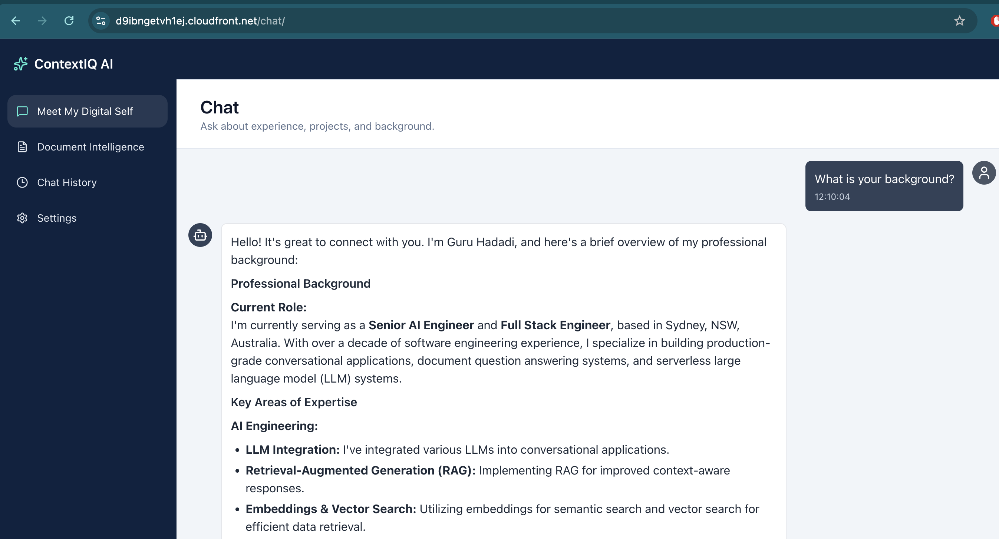
      <br/>
      <em>Chat interface and an example streamed answer</em>
    </td>
    <td width="50%" align="center">
      <strong>02 · Document Intelligence</strong><br/><br/>
      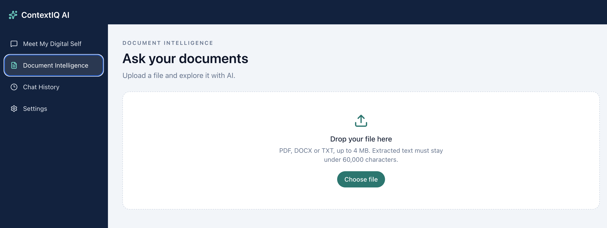
      <br/>
      <em>Upload panel, document metadata, and Q&A with source</em>
    </td>
  </tr>
  <tr>
    <td width="50%" align="center">
      <strong>03 · Conversation experience</strong><br/><br/>
      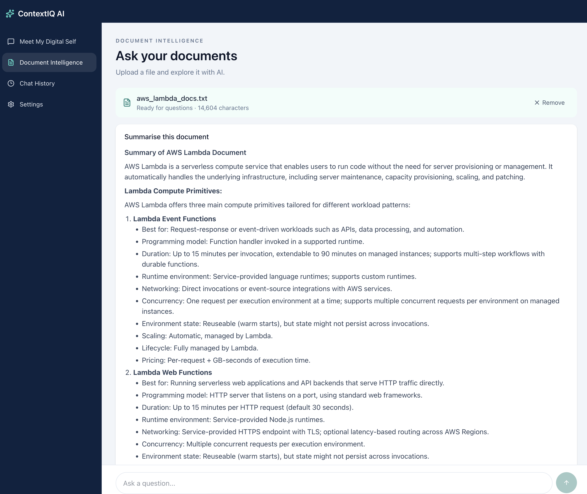
      <br/>
      <em>Markdown rendering, loading state, and chat UX</em>
    </td>
    <td width="50%" align="center">
      <strong>04 · Responsive layout</strong><br/><br/>
      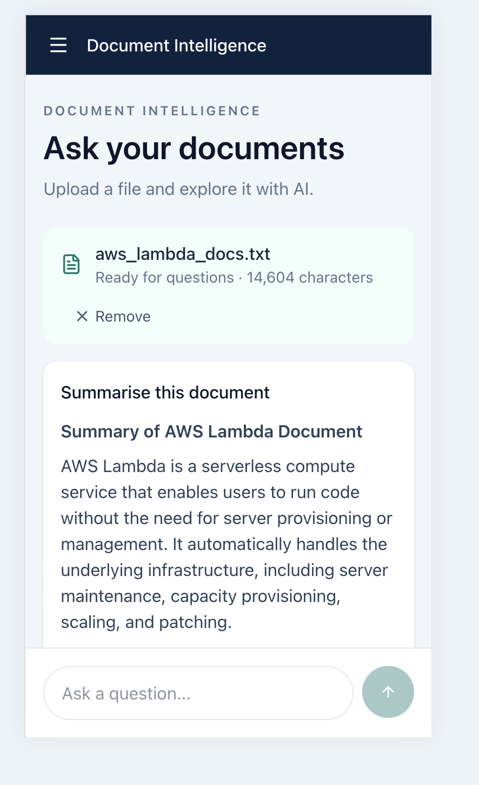
      <br/>
      <em>Mobile / narrow-screen experience</em>
    </td>
  </tr>
  <tr>
    <td width="50%" align="center">
      <strong>05 · AWS Lambda</strong><br/><br/>
      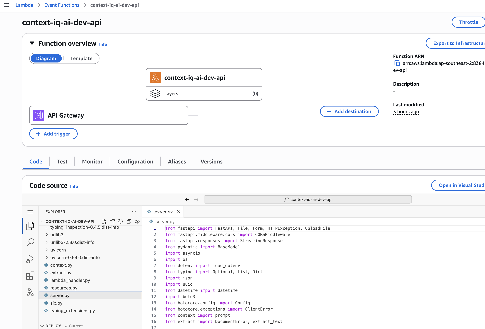
      <br/>
      <em>API function that runs the FastAPI service</em>
    </td>
    <td width="50%" align="center">
      <strong>06 · Amazon CloudFront</strong><br/><br/>
      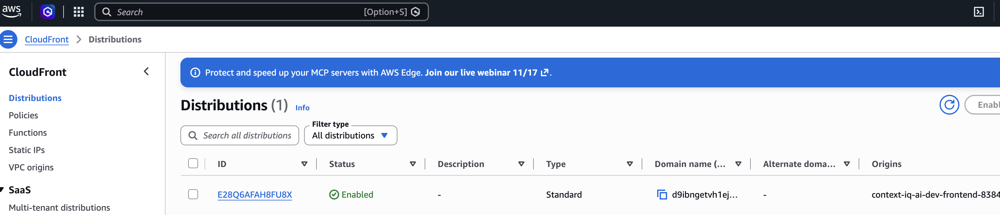
      <br/>
      <em>Distribution that serves the static UI</em>
    </td>
  </tr>
  <tr>
    <td colspan="2" align="center">
      <strong>07 · Amazon S3</strong><br/><br/>
      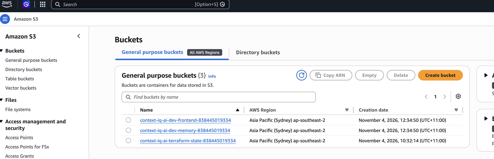
      <br/>
      <em>Buckets for the static site and conversation memory</em>
    </td>
  </tr>
</table>

## 🧰 Technology stack

| Layer                      | Technologies                                | Role                                                                               |
| -------------------------- | ------------------------------------------- | ---------------------------------------------------------------------------------- |
| **Frontend**               | Next.js, React, TypeScript, Tailwind CSS    | User interface, file upload, streamed chat, Markdown display                       |
| **Backend**                | Python, FastAPI, Mangum, Uvicorn            | REST/API processing, document extraction, Lambda adapter, local development        |
| **Generative AI**          | Amazon Bedrock, Amazon Nova                 | Managed model access (Bedrock) and LLM inference (Nova)                            |
| **Serverless compute**     | AWS Lambda                                  | Host the Python API                                                                |
| **API management**         | Amazon API Gateway                          | Expose backend endpoints                                                           |
| **Storage**                | Amazon S3 (frontend bucket + memory bucket) | Serve static Next.js assets; persist conversation JSON and extracted document text |
| **Delivery**               | Amazon CloudFront                           | Serve the static UI through a CDN                                                  |
| **Infrastructure as code** | Terraform                                   | Provision and manage AWS resources                                                 |
| **Packaging & deployment** | Docker, AWS CLI, `deploy.sh`                | Build/package backend and deploy application                                       |
| **Local tooling**          | `uv`, npm                                   | Python and frontend dependency management                                          |

> **CI/CD:** A push to `main` deploys the `dev` environment through [`.github/workflows/deploy.yml`](.github/workflows/deploy.yml). That workflow runs `./scripts/deploy.sh`. `test` and `prod` are started manually.

## 🏗️ Architecture

The diagram separates **static content delivery** from **API/inference traffic**. Double arrows represent communication in both directions; S3 is used for two different purposes.

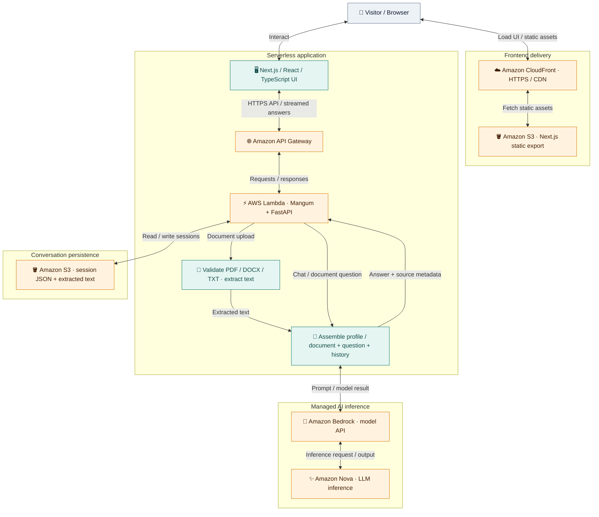

> **Flow clarification:** The visitor downloads the static Next.js application through **CloudFront ↔ S3**. Once loaded, the browser communicates with **API Gateway ↔ Lambda**, not with the static hosting bucket for chat requests. The API reads and writes **session JSON** in a separate S3 memory bucket. **Lambda calls Bedrock**, which invokes the **Amazon Nova model** and returns the generated response. Arrows are logical request/response flows; model execution occurs inside the managed Bedrock service, not in your Lambda.

### Request lifecycle — end to end

1. **Load application:** CloudFront serves the Next.js static export stored in the frontend S3 bucket.
2. **Send request:** The browser calls API Gateway; Lambda runs the FastAPI service through Mangum.
3. **Retrieve context:** The backend reads the session JSON from the S3 memory bucket (or local JSON when developing locally).
4. **Prepare prompt:** For Digital Self, it uses the curated professional profile and conversation; for Document Intelligence, it uses the extracted document text and question.
5. **Generate answer:** FastAPI calls **Amazon Bedrock**, which runs **Amazon Nova** to generate the reply.
6. **Return response:** The generated output travels back through Lambda and API Gateway to the browser, which renders the streamed Markdown response.
7. **Persist conversation:** The API saves updated messages and associated document text in S3 session JSON.

> **Local mode:** With Uvicorn, the same FastAPI endpoints run locally and use JSON files under `memory/` instead of the deployed S3 memory bucket.

## 🚀 Features

| Capability                      | Description                                                       | Status         |
| ------------------------------- | ----------------------------------------------------------------- | -------------- |
| 💬 **Meet My Digital Self**     | Conversational Q&A about a predefined engineering profile         | ✅ Implemented |
| 📄 **Document Intelligence**    | Upload one PDF, DOCX, or TXT document and ask questions           | ✅ Implemented |
| ⚡ **Streaming responses**      | See responses as they are generated                               | ✅ Implemented |
| 📝 **Markdown rendering**       | Read structured answers, lists, and code clearly                  | ✅ Implemented |
| 🔖 **Source attribution**       | Show a source line identifying the uploaded document              | ✅ Implemented |
| 🧠 **Conversation persistence** | Store session JSON locally or in S3 on Lambda                     | ✅ Implemented |
| 🛡️ **Upload limits**            | Reject documents over **4 MB** or **60,000 extracted characters** | ✅ Implemented |
| 🕘 **History screen**           | Reserved for a future conversation-reopening experience           | 🚧 Placeholder |
| ⚙️ **Settings screen**          | Reserved for future configuration                                 | 🚧 Placeholder |

### How the two experiences work

Both experiences use the same **Next.js → API Gateway → Lambda/FastAPI → Amazon Bedrock → Amazon Nova** request path. **S3 stores the deployed UI and conversation memory**, but the browser calls API Gateway directly for AI requests.

#### 💬 Experience 1 — Meet My Digital Self (`/chat/`)

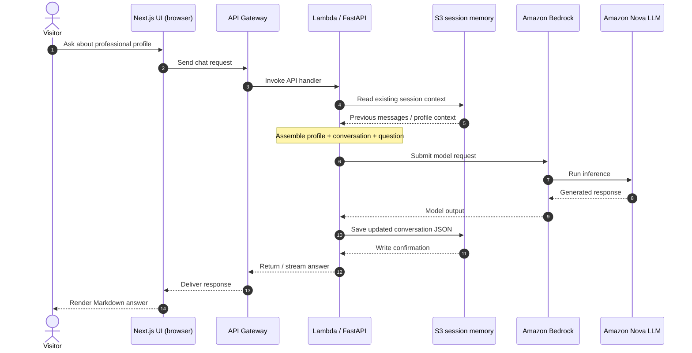

The assistant's answers are grounded in the curated professional profile and the conversation context. The deployed session history is held in the **S3 memory bucket**; locally it is stored as JSON under `memory/`.

#### 📄 Experience 2 — Document Intelligence (`/`)

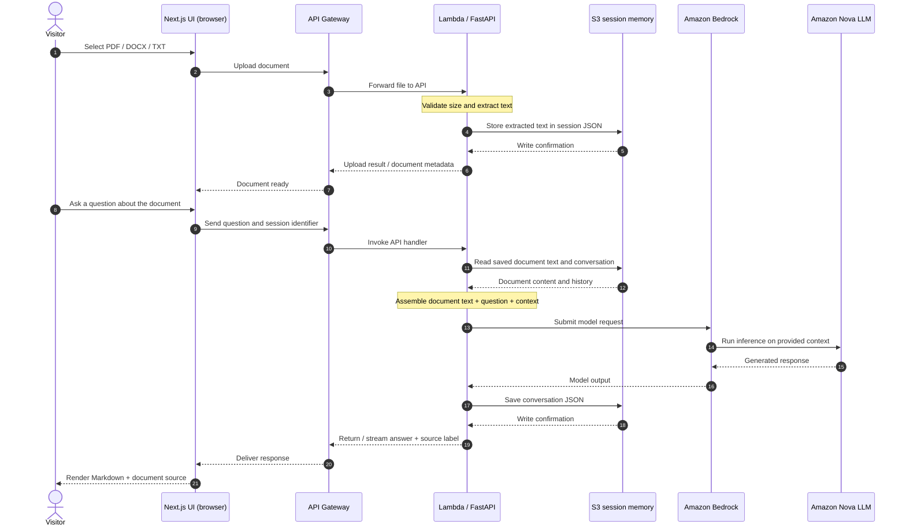

**No RAG or vector database:** the extracted document text is supplied to Amazon Nova through Bedrock as part of the model context. This design is intentionally suited to **one small document per conversation**, not large-scale document search.

**Document limits:** maximum **4 MB** per uploaded file and **60,000 characters** of extracted text. Oversized files are rejected rather than silently truncated. **Original file bytes are not retained** after extraction; the extracted text **is retained** in session JSON (S3 on AWS, local JSON during development). Source attribution identifies the uploaded filename, not a verified passage/page citation.

---

## 📁 Application routes

| Route        | Page                  | Notes                                                              |
| ------------ | --------------------- | ------------------------------------------------------------------ |
| `/`          | Document Intelligence | One-document upload + Q&A                                          |
| `/chat/`     | Meet My Digital Self  | Professional-profile chat                                          |
| `/history/`  | Chat History          | Placeholder; reopening historical conversations is not implemented |
| `/settings/` | Settings              | Placeholder                                                        |

The frontend uses a **static export** with trailing slashes so S3 can serve each route as an `index.html` page.

---

## 💻 Run locally

### Prerequisites

- Node.js and npm
- Python and [`uv`](https://docs.astral.sh/uv/)
- AWS credentials with permission to invoke the configured Amazon Bedrock model in **`ap-southeast-2`**
- Access to the selected Bedrock model in your AWS account/region

### 1 · Start the API

```bash
cd backend
uv sync
uv run uvicorn server:app --reload
```

Backend URL: **http://localhost:8000**

### 2 · Start the frontend

In a second terminal:

```bash
cd frontend
npm install
npm run dev
```

Frontend URL: **http://localhost:3000**

The frontend uses `NEXT_PUBLIC_API_URL` if set, otherwise it defaults to `http://localhost:8000`.

For example, in `frontend/.env.local`:

```dotenv
NEXT_PUBLIC_API_URL=http://localhost:8000
```

> Never commit AWS credentials, `.env.local`, personal documents, or session-memory files.

---

## ☁️ Deploy to AWS

Ensure you have configured the **AWS CLI**, **Docker**, and **Terraform**. From the repository root:

```bash
./scripts/deploy.sh dev
```

The deployment script packages the FastAPI Lambda, applies the Terraform workspace, builds the static Next.js frontend, and uploads it to S3 behind CloudFront.

### Deployment workflow

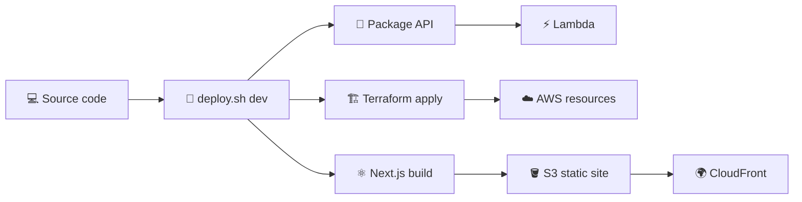

**GitHub Actions** runs the same `./scripts/deploy.sh` path.

| Workflow | File | When it runs |
| --- | --- | --- |
| Deploy | [`.github/workflows/deploy.yml`](.github/workflows/deploy.yml) | Every push to `main` deploys `dev`. A manual run can deploy `dev`, `test`, or `prod`. |
| Destroy | [`.github/workflows/destroy.yml`](.github/workflows/destroy.yml) | Manual only. The confirmation input must match the environment name before teardown starts. |

AWS access uses GitHub OIDC. Each environment stores `AWS_ROLE_ARN`, `AWS_ACCOUNT_ID`, and `DEFAULT_AWS_REGION`. The workflows do not keep long-lived AWS keys, and they do not run automated tests yet.

---

## 🔐 Security, data handling & limitations

- **No original-file storage:** Uploaded document bytes are used for extraction but are not kept as the original document.
- **Extracted text is persisted:** Text is saved with the conversation in a local JSON file or an S3 memory bucket; it is **not ephemeral** by default.
- **Model processing:** Questions, relevant profile/document content, and conversation context are sent to Amazon Bedrock for inference.
- **Upload validation:** A file over **4 MB** or **60,000 extracted characters** is rejected.
- **Context window:** Document Q&A is intended for relatively small documents. Model context/token limits still apply, even within the character cap.
- **Source labels:** A source line identifies the document; it is not a verified page-by-page citation or a retrieval-based evidence system.
- **Session isolation:** Before using the demo with sensitive documents or multiple untrusted users, verify session access controls, retention/deletion policy, S3 permissions, CORS settings, and log redaction.
- **Scope:** This is a portfolio demonstration, not a claim of audited compliance or production-grade multi-tenant security.

## 🗺️ Roadmap

- [x] Digital-self conversations
- [x] Single-document Q&A without RAG
- [x] Streamed Markdown responses
- [x] Local / S3-backed session memory
- [x] Serverless AWS deployment workflow
- [ ] Reopen past conversations from Chat History
- [ ] Add meaningful Settings controls
- [x] GitHub Actions deployment workflow
- [ ] Automated tests

---

<div align="center">

### Built to explore practical, production-oriented AI engineering

**Full-stack development · Managed LLM integration · Serverless AWS · Infrastructure as code**

<sub>ContextIQ AI · Portfolio project</sub>

</div>
